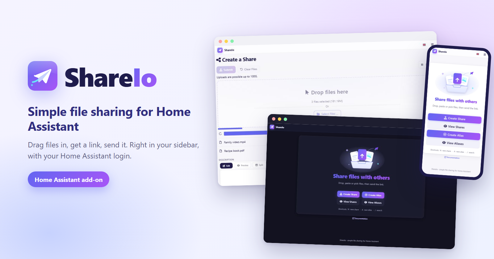
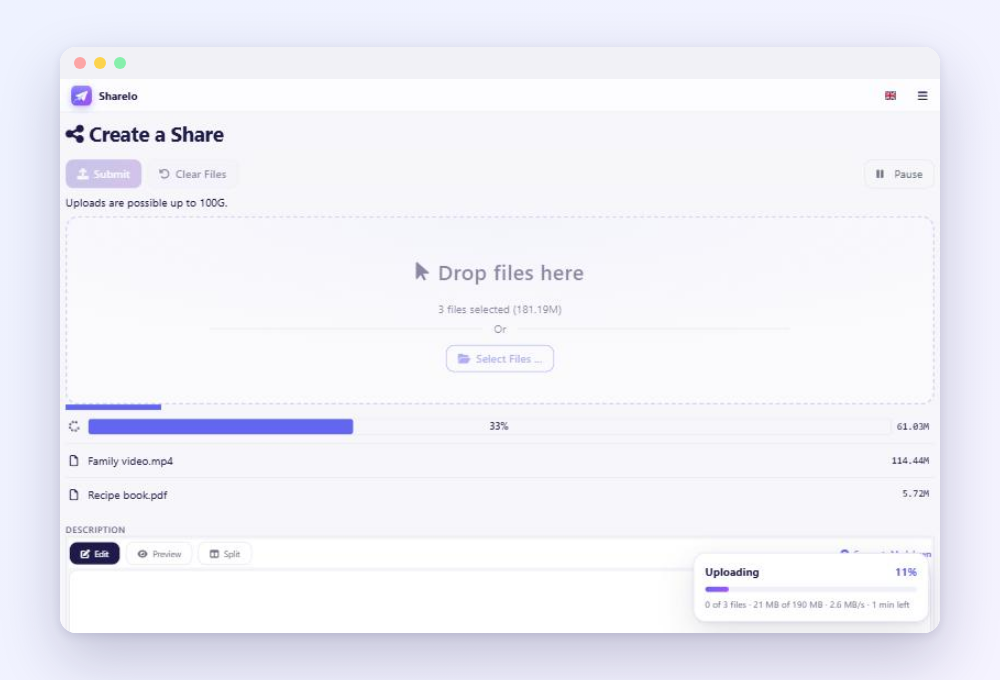
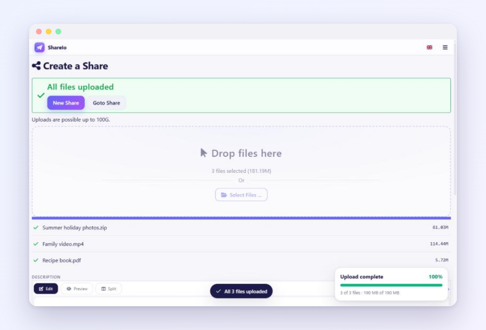
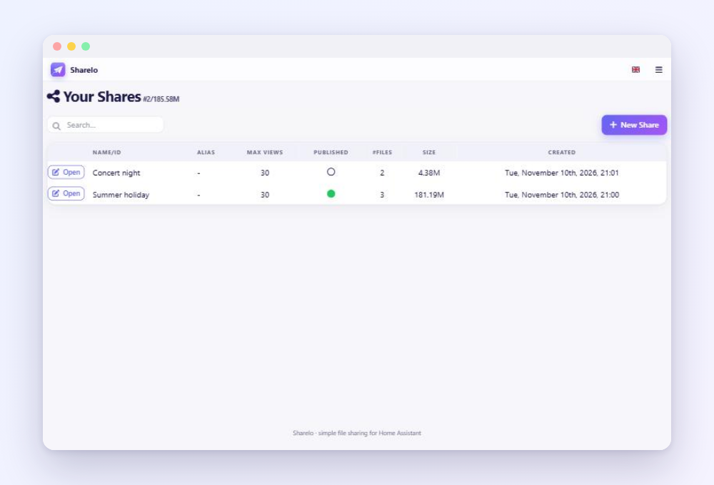
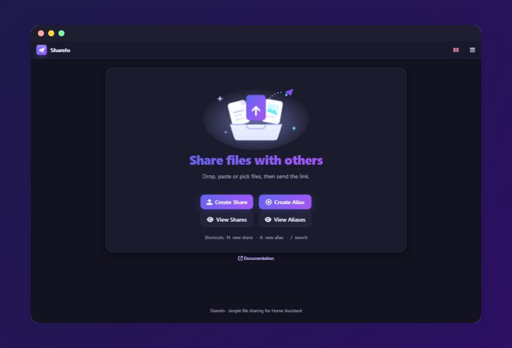
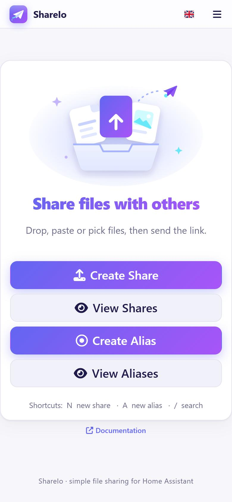

  

  
  &nbsp;
  

  
  

# ShareIo

Simple, self-hosted file sharing for Home Assistant. Drag files in, get a link,
send it. Or create an upload link so others can send files to you. ShareIo lives
in the Home Assistant sidebar and logs you in with your Home Assistant account,
so there is nothing to set up.

## Install

1. Install and start the [MariaDB add-on][addon-mariadb] (ShareIo stores its
   data there).
2. Click **Add repository** above, or go to **Settings → Add-ons → Add-on
   Store**, open the **⋮** menu, choose **Repositories** and add
   `https://github.com/arobe14040/ShareIo`.
3. Click **Open add-on** above (or find **ShareIo** in the store), install and
   start it, then open **ShareIo** from the sidebar.

## Features

  
  

- **Right in the sidebar** with automatic Home Assistant login, also for
  non-admin users
- **Drag and drop or paste** files; drop them anywhere on the window
- **Upload progress** with speed and time left, and a clear confirmation (plus
  a notification and chime when the tab is in the background)
- **Resumes interrupted uploads** where they stopped, and survives dropped
  connections
- **Share with a friend:** a link and QR code that opens the share for anyone
  with a login to your Home Assistant
- **Upload links** so others can send files to you
- **Light and dark theme** that follows your device, installable as an app

  
  

  

See the [documentation](shareio/DOCS.md) for public sharing, advanced options
and troubleshooting.

## Credits

A fork of [addon-sharry][upstream-addon] by Mike Degatano, which is no longer
maintained. The file sharing server is the open-source
[Sharry](https://github.com/eikek/sharry) project by eikek. MIT License, see
[LICENSE](LICENSE).

[addon-mariadb]: https://github.com/home-assistant/addons/tree/master/mariadb
[upstream-addon]: https://github.com/mdegat01/addon-sharry
